# Part 2. Synchronous REINFORCE and GRPO

GRPO reaches 99% evaluation success by step 20 and ends at 99%, while REINFORCE ends at 56.5% after 50 steps. The final eval/pass@4 is 100% for GRPO and 94% for REINFORCE. This is expected because GRPO compares attempts on the same task and can penalize unsuccessful attempts, while REINFORCE only reinforces successful ones. However, GRPO also uses eight times as many rollouts per step and a different loss, so this is not an equal-budget comparison.

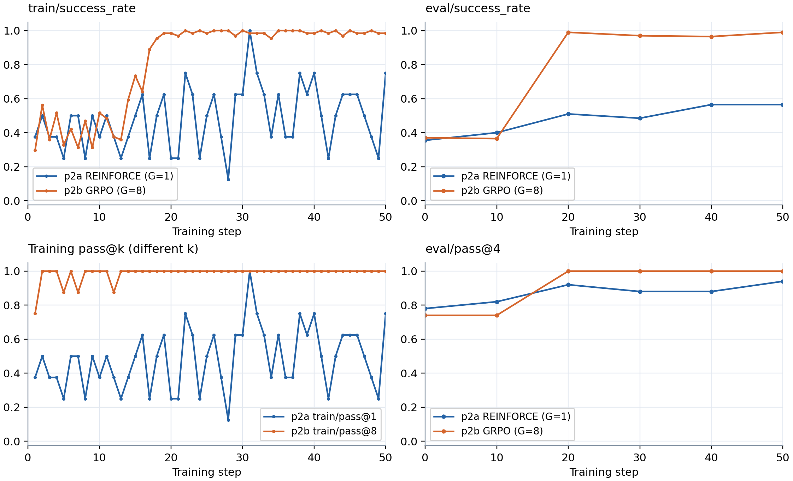

Figure 1. GRPO's training and evaluation success rise faster, and train/pass@8 saturates early. REINFORCE's train/pass@1 equals its training success. The two training pass@k curves use different k.

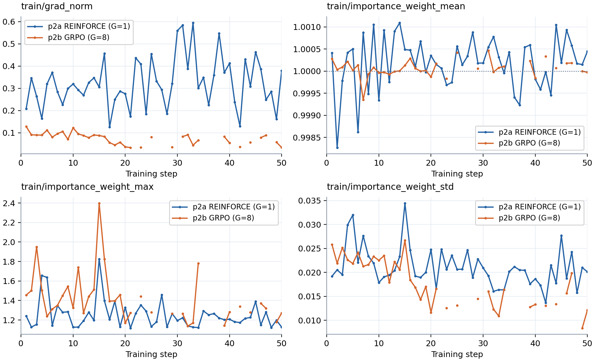

Figure 2. Gradient norms show no large spikes. The mean importance weight stays near 1. The maximum is below 2.4 and the standard deviation is below 0.035. Gaps mark steps without updates.

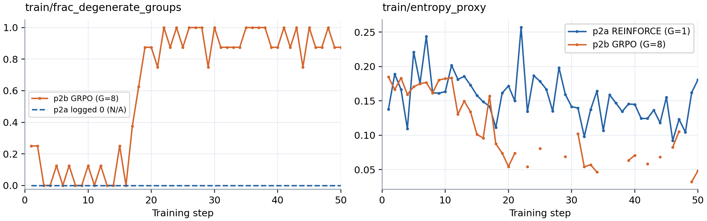

Figure 3. GRPO's entropy proxy falls and its degenerate fraction rises as more groups contain only successful attempts. The trainer skips 14 updates when every group in a batch has zero advantage. REINFORCE's entropy fluctuates, and its degenerate fraction is N/A because it has no group baseline.

# Part 3. Asynchronous GRPO

p3's final eval/success_rate and eval/pass@4 are both 100%. The mean train/step_time_s is 30.48 s for p3 and 41.51 s for p2b, so p3 is 1.36 times as fast. p3 samples data and updates the model at the same time. It learns more slowly per iteration. At step 20, its evaluation success is 60%, while p2b's is 99%.

Figure 4. Training success and train/pass@8 rise as learning progresses. eval/pass@4 reaches 100% before eval/success_rate.

- Step 5 (task number_search.train.48, policy_version 3, rollout 0). The environment says 321 is too low, but the agent guesses 267 and 291. It ignores the lower bound, then scans 326, 334, 342 and runs out of guesses.

- Step 25 (task number_search.train.241, policy_version 23, rollout 0). It keeps guesses within the bounds and mostly bisects (645, 825, 735, 690, ...). It eventually finds 697.

- Step 50 (task number_search.train.459, policy_version 45, rollout 0). It guesses 737, 652, 694, 715, 726, 720, 717 and finds the target in seven attempts. It now makes roughly midpoint jumps instead of the early rollout's slow scan.

Figure 5. Gradient norms remain small. p3's importance-weight means range from 0.9988 to 1.0008. Individual ratios span 0.340 to 2.479, while p2b's range is 0.462 to 2.397. Standard deviations are 0.017-0.033 for p3 and 0.008-0.027 for p2b. The mean alone does not show these differences between individual tokens. Gaps mark steps without updates.

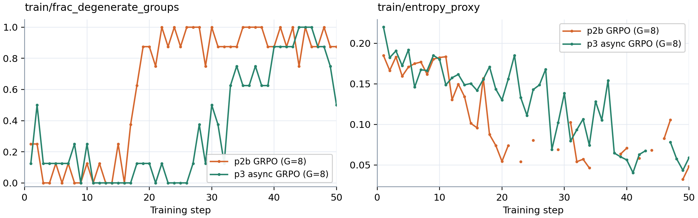

Figure 6. Entropy proxy decreases and the degenerate-group fraction rises as success improves. These changes occur later than in p2b. The trainer skips three updates in p3 because all attempts in those batches succeed. p3 therefore has 47 optimizer updates across 50 iterations.

# Part 4.1. Group Size

Final evaluation success is 56.5% for REINFORCE, 89% for GRPO with G=2, and 99% for GRPO with G=8. The smaller group estimates the baseline from fewer samples, so the baseline has higher variance and adds more noise to the advantages. In the first 20 steps, 61.9% of G=2 groups are degenerate, versus 20.0% for G=8. G=2 supplies only 6.1 useful sequences per step on average over this period, versus 51.2 for G=8, which helps explain its slower learning. REINFORCE's degenerate fraction is N/A. It also uses a different advantage rule and loss, so this is not a pure group-size comparison.

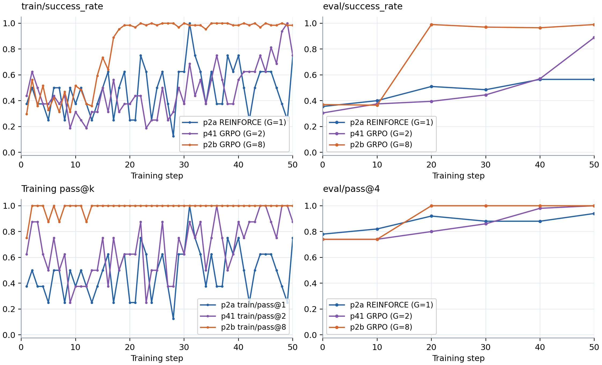

Figure 7. G=8 improves fastest, while G=2 improves mainly near the end. Both GRPO runs reach 100% eval/pass@4, versus 94% for REINFORCE. Training pass@1, pass@2, and pass@8 use different k and are not directly comparable.

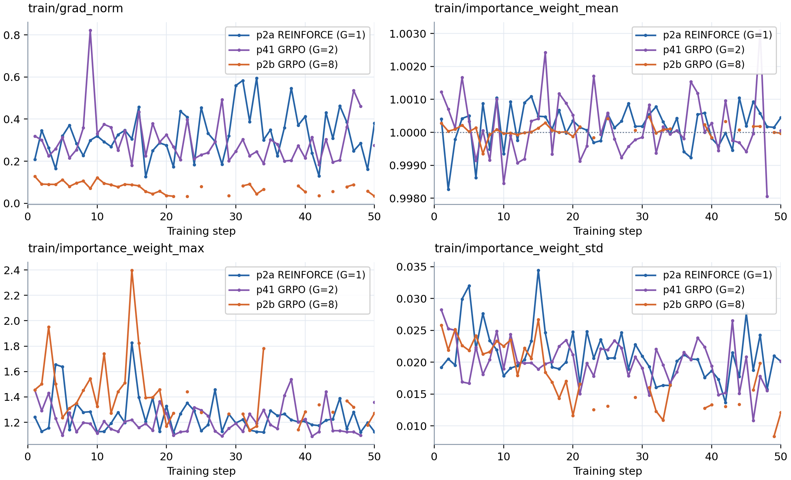

Figure 8. G=2 has larger gradient norms than G=8. All three runs have mean importance weights near 1, maxima below 2.4, and standard deviations below 0.035. Gaps mark steps without updates.

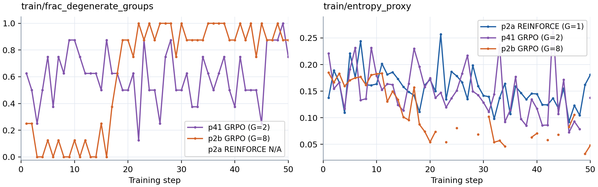

Figure 9. G=2 has many degenerate groups early. G=8 reaches a high degenerate fraction later because most attempts succeed. Its entropy proxy also falls earlier, while G=2 and REINFORCE fluctuate more.

# Part 4.2. Synchronous vs. Asynchronous Training

The asynchronous run is 1.36 times as fast per step. Its workers sample data while the learner updates the model, so the two stages spend less time waiting for each other. The learner accepts 400 groups and discards 62 groups that exceed the staleness limit. Its importance weights have wider extremes and larger standard deviations than the synchronous run, although their means stay near 1. It learns more slowly per iteration but reaches similar final accuracy, so these results show no clear final accuracy cost from stale data. The runs do not isolate staleness as the cause of slower learning.

Run | Mean step time (s) | Final eval/success_rate
--- | --- | ---
p2b synchronous | 41.51 | 99%
p3 asynchronous | 30.48 | 100%

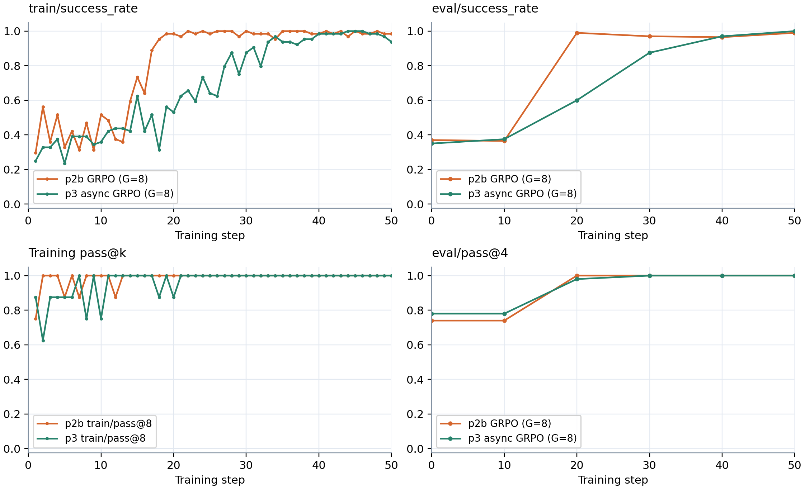

Figure 10. p3's training and evaluation success rise later than p2b's. Both training pass@8 and evaluation pass@4 approach 100%.

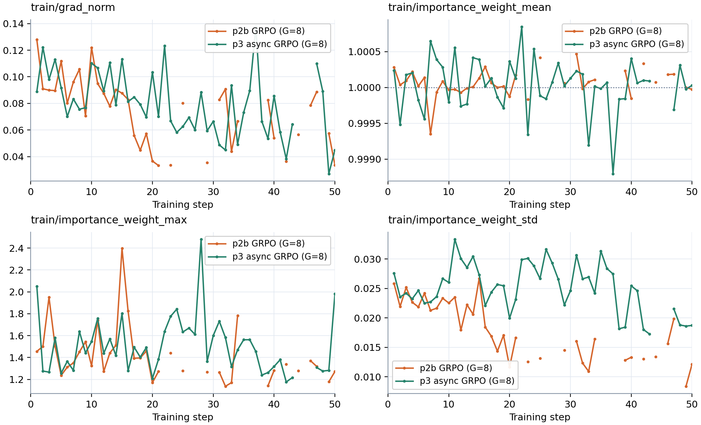

Figure 11. Neither run shows large gradient spikes. Importance-weight means stay near 1, but p3's maximum ratio reaches 2.48 versus 2.40 for p2b, and its standard deviation reaches 0.033 versus 0.027.

Figure 12. p3's degenerate fraction rises and its entropy proxy falls later than p2b's, consistent with its slower improvement per iteration.

# Part 4.3. Importance Weighting under Higher Staleness

Both runs allow staleness up to four versions. The iw run uses PPO, while noiw uses advantage-weighted cross-entropy. At step 20, evaluation success is 92% for noiw and 59.5% for iw. Their final success rates are 99.5% and 99%, respectively, and both reach 100% eval/pass@4. This experiment does not show an accuracy benefit from importance weighting, although noiw has larger importance-ratio fluctuations. One run per loss is not enough to conclude that noiw is generally better.

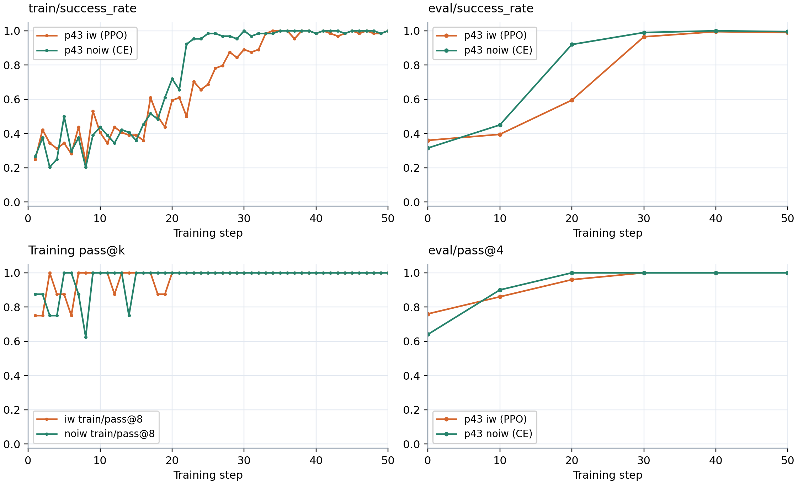

Figure 13. noiw's training and evaluation success improve sooner. Training pass@8 and evaluation pass@4 reach 100% in both runs.

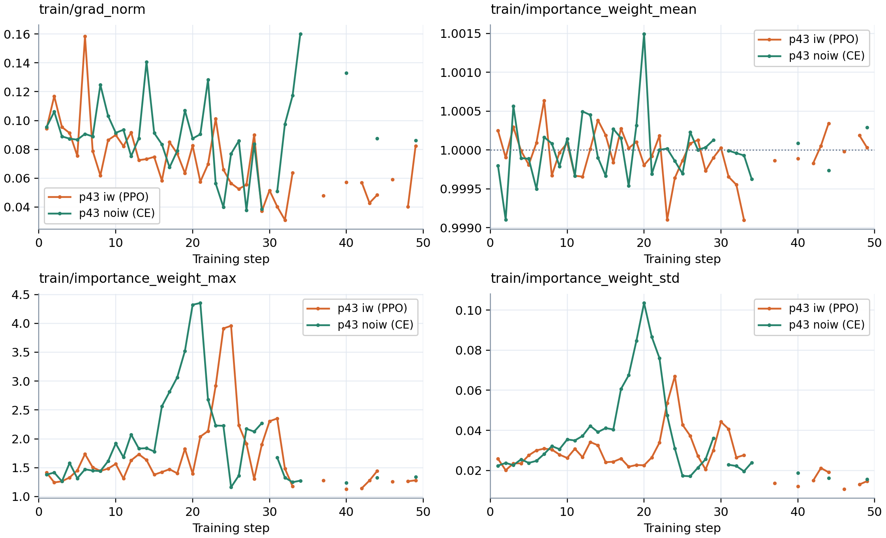

Figure 14. Gradient norms are similar and importance-weight means stay near 1. noiw's maximum ratio reaches 4.35 versus 3.96 for iw, and its standard deviation reaches 0.104 versus 0.067. These ratios are diagnostics only in noiw and do not enter its loss.

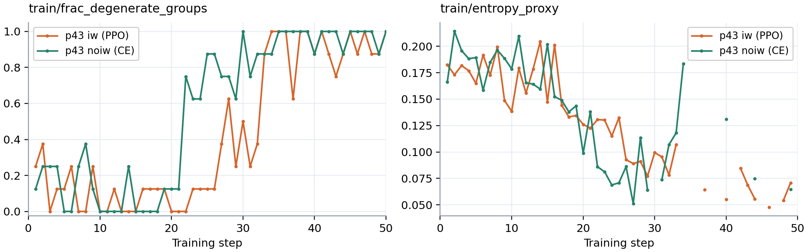

Figure 15. noiw's entropy proxy falls and its degenerate fraction rises earlier. Both runs skip updates near the end when all attempts in a batch succeed. Gaps in the other diagnostic curves correspond to these steps.

# Part 5. TextCraft-Synth

On the full validation splits with four attempts per task, fine-tuning improves medium success from 10.92% to 65.26% and pass@4 from 28.17% to 77.46%. Both models score 0% on hard, so training on medium does not produce success on harder tasks in this experiment. The fine-tuned model averages 71.41 of 75 turns on hard, which suggests difficulty with longer plans.

Model | Split | success_rate | pass@4
--- | --- | --- | ---
Fine-tuned | Medium | 65.26% | 77.46%
Base | Medium | 10.92% | 28.17%
Fine-tuned | Hard | 0.00% | 0.00%
Base | Hard | 0.00% | 0.00%

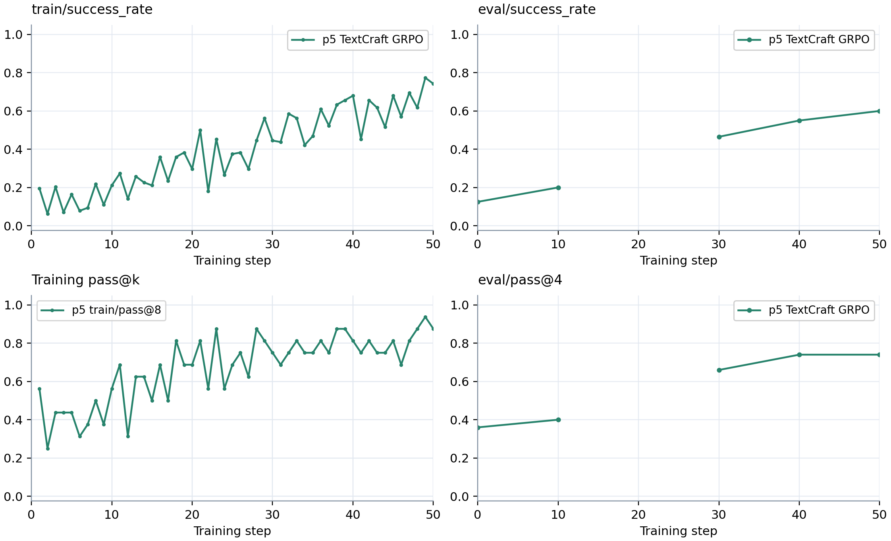

Figure 16. Training and evaluation success improve. These periodic evaluations use 50 medium tasks. The run resumed from step 20 after a server failure and completed 50 updates. The missing step-20 evaluation appears as a gap.

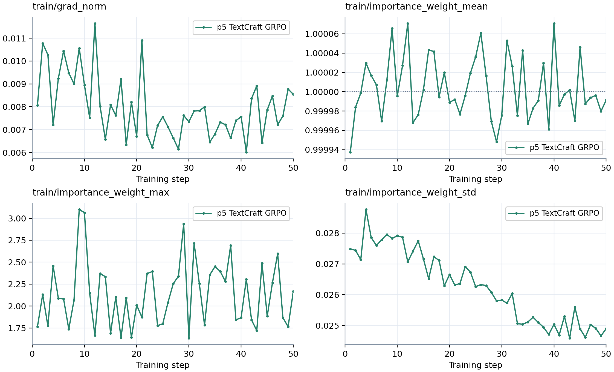

Figure 17. Gradient norms remain small. Mean importance weights stay near 1, maxima stay below 3.11, and standard deviations stay below 0.029.

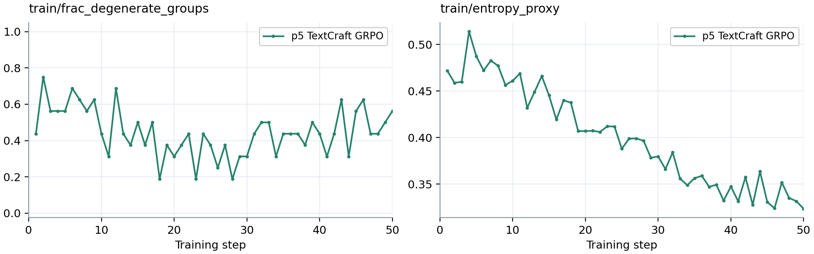

Figure 18. The degenerate-group fraction fluctuates, while the entropy proxy generally decreases. No batch is fully degenerate, so no update is skipped.
